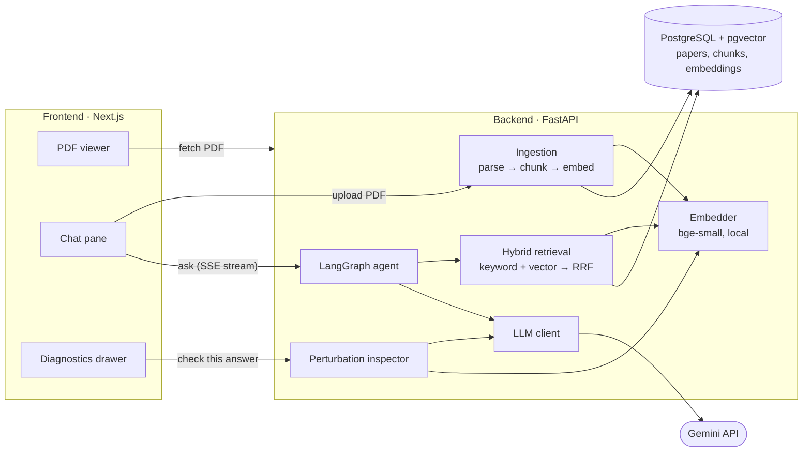

# Research Companion RAG Agent

Auditable research companion for academic papers: hybrid-search RAG with page-linked citations and a perturbation-based hallucination inspector.

This web app will make it easier for you to comprehend research papers and understand the big idea faster.

This uses a RAG system and references items in the given ground truth.

## Architecture



**Uploading a paper**

1. PyMuPDF extracts the text with page numbers and positions.
2. The text is split into chunks, embedded locally with `BAAI/bge-small-en-v1.5`, and stored in Postgres.
3. Each chunk keeps its page and position so citations can point back to it.

**Asking a question** (`POST /documents/{id}/ask/stream`)

```
classify ─► [decompose if multi-step] ─► retrieve ─► synthesize ─► check citations
                                             └─ nothing found ─► refuse
```

1. **Classify:** a small model decides whether the question is simple or multi-step. Multi-step questions are **decomposed** into sub-questions.
2. **Retrieve:** each (sub-)question runs a hybrid search *within the selected paper only*. Postgres full-text search and exact vector search are fused with Reciprocal Rank Fusion.
3. **Synthesize:** the model answers only from the retrieved passages and cites them as `[n]`. If nothing is found, the agent **refuses** instead of answering from memory.
4. **Check citations:** invalid citations are removed and uncited answers are flagged.
5. **Stream:** status updates and answer tokens are sent to the chat as Server-Sent Events. Clicking a citation jumps the PDF viewer to its page.

**Checking an answer** (`POST /documents/{id}/diagnose`, on request)

1. The question is re-run four ways: reworded, passages reordered, an unrelated passage added, and the most-cited passage removed.
2. Each new answer is compared with the original using embedding similarity and a claim-by-claim judge call.
3. The results are combined into a 0–1 hallucination-risk score. The drawer shows the overall score and one row per check.

| Folder | Role |
|---|---|
| `backend/app/api/routes/` | HTTP endpoints only |
| `backend/app/ingestion/` | PDF parsing, chunking, storage |
| `backend/app/retrieval/` | Keyword, vector, and fused hybrid search |
| `backend/app/agent/` | LangGraph graph, one file per node in `nodes/` |
| `backend/app/diagnostics/` | Perturbations, answer comparison, risk score |
| `backend/app/llm/` | Gemini and embedding clients (the only code that calls a model) |
| `frontend/src/components/` | PDF viewer, chat, citations, diagnostics drawer |
| `docs/decisions/` | Design decisions (ADRs) behind each part |

All model calls use the Gemini API: Flash for answers, and Flash-Lite for routing and the answer checks. The design reasoning is recorded in [`docs/decisions/`](docs/decisions/), from 0001 (chunk schema) to 0008 (diagnostics drawer).

## Prerequisites
- [Docker Desktop](https://www.docker.com/products/docker-desktop/) (running)
- [uv](https://docs.astral.sh/uv/) for local backend development (installs Python 3.12 itself)
- A Gemini API key from Google AI Studio

## Setup
```bash
cp .env.example .env   # then fill in LLM_API_KEY
```
`.env` is gitignored; never commit it.

## Run with Docker (full stack)
```bash
docker compose up --build
```
- **The app: http://localhost:3000** (upload a paper, open it, ask questions)
- API health: http://localhost:8000/health
- Interactive API docs: http://localhost:8000/docs

The backend applies database migrations automatically on startup. Postgres is exposed on host
port **5433** (not 5432) to avoid clashing with a locally installed Postgres.

## Upload a paper
Use the **Try it out** button on `POST /documents` at http://localhost:8000/docs, or:
```bash
curl -F "file=@paper.pdf" http://localhost:8000/documents   # -> doc_id, page_count, chunk_count
curl http://localhost:8000/documents                        # list uploaded papers
```
Ingestion takes roughly 15–25 s per paper on a laptop CPU (embedding dominates). The original
PDF is stored in the database with its chunks (older versions kept it in `backend/data/uploads/`;
migration 0002 imports those).

## Ask a question about a paper
Needs `LLM_API_KEY` (a free Gemini API key from Google AI Studio) in `.env`.
```bash
curl -X POST http://localhost:8000/documents/<doc_id>/ask \
  -H "Content-Type: application/json" \
  -d '{"question": "Which datasets were used to evaluate the method?"}'
```
The answer cites passages as `[n]`; each citation has its page, text, and bounding boxes.
`refused: true` means the paper doesn't answer the question. A `503` means Gemini is busy:
retry, or set `LLM_ANSWER_MODEL` to the Flash-Lite model.

To watch the answer arrive as it is written, use the streaming endpoint (`-N` turns off
curl's buffering):
```bash
curl -N -X POST http://localhost:8000/documents/<doc_id>/ask/stream   -H "Content-Type: application/json"   -d '{"question": "Which datasets were used to evaluate the method?"}'
```
It sends Server-Sent Events: `status` (each step as it starts), `sub_questions`, `token`
(answer text), then `done` (the checked answer with citations, same as `/ask`) or `error`.
Lines starting with `:` are keep-alive pings.

## Check an answer's hallucination risk
The perturbation inspector re-asks the question with one controlled change at a time and
measures how far the answer moves. Send back the question, the `answer`, and the
`passage_ids` from an `/ask` response (plus `sub_questions`, if any):
```bash
curl -X POST http://localhost:8000/documents/<doc_id>/diagnose   -H "Content-Type: application/json"   -d '{"question": "...", "answer": "...", "passage_ids": ["...", "..."]}'
```
`uncertainty` is 0 (stable) to 1 (unstable). `signals` gives a breakdown for each change:
`paraphrase` (reworded question), `reorder` (passages reversed), `distractor` (an unrelated
passage of the paper added), and `drop_cited` (the most-cited passage removed; shown but not
scored by default). Each has its `risk`, embedding `similarity`, `claim_agreement` with the
original's `claims`, and the perturbed answer itself. It makes about six Flash-Lite calls,
typically 5-20 seconds.

## Search a paper
Searches are scoped to one paper (hybrid keyword + vector search, fused with RRF):
```bash
curl -X POST http://localhost:8000/documents/<doc_id>/search \
  -H "Content-Type: application/json" \
  -d '{"query": "Which datasets were used?", "top_k": 5}'
```
Each hit has the page, text, bounding boxes, and its `keyword_rank` / `vector_rank`.

## Using the app
1. On http://localhost:3000, upload a PDF (processing takes about 20 s) or pick an uploaded paper.
2. The paper opens with the PDF on the left and the chat on the right.
3. Ask a question. You see each step (understanding, searching, writing), then the answer streams in.
4. Click a citation number, or a source under the answer, to jump to that page with the cited
   passage highlighted. "Show passage" displays the quoted text.
5. To check an answer, click **Check this answer** under it. The question is re-asked with small
   changes (5-20 s, about six Flash-Lite calls), then a badge shows the hallucination risk
   (Low < 0.2, Medium < 0.4, High). Click the badge for the breakdown: each check's risk, the
   answer it produced, and the claims compared. The score measures consistency, not correctness.
6. Drag the handle between the PDF and the chat to resize them (or focus it and use ←/→;
   double-click resets to 50/50). The theme button in the header cycles Light, Dark, and System
   (follows your OS). Both choices are remembered in your browser.

## Run the frontend locally (hot reload)
Needs Node.js 20.18+ (24 LTS recommended) and the backend on port 8000.
```bash
cd frontend
npm install
npm run dev                      # http://localhost:3000
```
The browser calls the API directly, at `NEXT_PUBLIC_API_URL` (default `http://localhost:8000`).
This value is compiled into the browser code at **build time**: after changing it, rebuild
(`docker compose build frontend`). The backend only accepts browser requests from the origins in
`CORS_ORIGINS` (default `http://localhost:3000`).

## Run the backend locally (auto-reload)
```bash
docker compose up -d db          # database only
cd backend
uv sync                          # install dependencies
uv run alembic upgrade head      # create/update tables
uv run uvicorn app.main:app --reload
```

## Tests
```bash
cd backend
uv run pytest tests/unit         # fast, no database needed
uv run pytest                    # everything; integration tests need `docker compose up -d db`

cd frontend
npm test                         # Vitest + React Testing Library
npm run typecheck && npm run lint
```

## Evaluation
The question set is in `eval/queries/queries.jsonl` (29 questions over four sample papers,
each with expected pages and a reference answer). Run the scripts from `backend/`, with the
database up and the papers uploaded under the filenames in the question file:
```bash
uv run python -m app.evaluation.retrieval_run   # keyword vs vector vs hybrid; no model calls
uv run python -m app.evaluation.answer_run      # needs the backend running; resumable
uv run python -m app.evaluation.answer_run --checks 3 --only bb-01,meta-02   # stability
uv run python -m app.evaluation.labels          # writes eval/results/labels.csv to label by hand
uv run python -m app.evaluation.summary         # tables from results + labels -> summary.md
```
The answer run makes roughly 3 model calls per answer and 6 per check, and pauses between
requests to stay within free-tier limits. Method and reasoning: `docs/decisions/0009-evaluation-method.md`.

## Deploy (public demo)
The demo runs on free tiers: **Vercel** (frontend), **Google Cloud Run** (backend), and
**Neon** (Postgres + pgvector). It is read-only: visitors ask about the loaded papers but can't
upload. See [ADR 0011](docs/decisions/0011-deployment.md) for why.

Only load papers whose licence allows redistribution (e.g. CC BY): the app serves the full PDF.

### 1. Database (Neon)
1. Create a project at [neon.com](https://neon.com) in a US East region.
2. Copy the **direct** connection string (not the pooled one) and change its start from
   `postgresql://` to `postgresql+psycopg://`. Keep `?sslmode=require` at the end.

No manual migration needed: the backend migrates on startup.

### 2. Backend (Cloud Run)
1. Create a Google Cloud project, link a billing account, and add a budget alert
   (**Billing → Budgets & alerts**, e.g. $1).
2. Install the [gcloud CLI](https://cloud.google.com/sdk/docs/install), then:
   ```bash
   gcloud auth login
   gcloud config set project YOUR_PROJECT_ID
   gcloud services enable run.googleapis.com cloudbuild.googleapis.com artifactregistry.googleapis.com secretmanager.googleapis.com
   ```
   (`gcloud init` already does the login and project steps.) Commands below are one line each;
   keep the quotes, since PowerShell splits unquoted commas into separate arguments.
3. In **Security → Secret Manager**, create two secrets: `database-url` (the Neon string from
   step 1) and `gemini-api-key`. Then let the project's default service account read them and
   build from source (new projects give it no roles; the project number comes from
   `gcloud projects describe YOUR_PROJECT_ID --format="value(projectNumber)"`):
   ```bash
   gcloud projects add-iam-policy-binding YOUR_PROJECT_ID --member=serviceAccount:YOUR_PROJECT_NUMBER-compute@developer.gserviceaccount.com --role=roles/secretmanager.secretAccessor
   gcloud projects add-iam-policy-binding YOUR_PROJECT_ID --member=serviceAccount:YOUR_PROJECT_NUMBER-compute@developer.gserviceaccount.com --role=roles/run.builder
   ```
4. Build and deploy from the repo root (uploads on for now, to load the papers):
   ```bash
   gcloud run deploy research-companion-api --source backend --region us-east1 --allow-unauthenticated --memory 1Gi --cpu 1 --min-instances 0 --max-instances 1 --set-secrets "DATABASE_URL=database-url:latest,LLM_API_KEY=gemini-api-key:latest" --set-env-vars "LLM_ANSWER_MODEL=gemini-3.5-flash-lite,LLM_LIGHT_MODEL=gemini-3.5-flash-lite,EMBEDDING_MODEL=BAAI/bge-small-en-v1.5,ALLOW_UPLOADS=true"
   ```
   It prints the service URL (`https://research-companion-api-....run.app`). Check
   `<URL>/health`.
5. Load the papers, then turn uploads off:
   ```bash
   curl.exe -F "file=@backend/data/papers/black-box.pdf" <URL>/documents
   gcloud run services update research-companion-api --region us-east1 --update-env-vars ALLOW_UPLOADS=false
   ```

### 3. Frontend (Vercel)
1. At [vercel.com](https://vercel.com), **Add New → Project** and import this GitHub repo.
2. Set **Root Directory** to `frontend` and add the environment variable
   `NEXT_PUBLIC_API_URL` = the Cloud Run URL (no trailing slash). Deploy.
3. Allow the Vercel site to call the backend:
   ```bash
   gcloud run services update research-companion-api --region us-east1 --update-env-vars CORS_ORIGINS=https://YOUR-APP.vercel.app
   ```

Redeploy the backend after code changes by re-running the `gcloud run deploy` command from
step 2.4 with `ALLOW_UPLOADS=false`; Vercel redeploys the frontend on every push to `main`.

## Stopping
```bash
docker compose down              # stop containers, keep data
docker compose down -v           # stop and DELETE the database (all papers)
```
Press `Ctrl+C` to stop a locally running `uvicorn`.

## Troubleshooting
- **The app says it can't reach the backend:** check http://localhost:8000/health. If the
  backend runs but the browser console shows a CORS error, add the page's origin to
  `CORS_ORIGINS` in `.env` and restart the backend.
- **The PDF pane says it couldn't load the PDF** although questions work: the database has no
  copy of the original (a paper uploaded before PDFs were stored in the database whose file was
  already gone); upload the paper again.
- **The demo has no upload button:** the backend runs with `ALLOW_UPLOADS=false`; set it to
  `true` (in `.env` locally) and restart the backend.
- **`docker` not recognized:** restart VS Code / your terminal after installing Docker Desktop.
- **`invalid peer certificate: UnknownIssuer` from uv:** add `--system-certs` (e.g.
  `uv run --system-certs pytest`) so uv trusts the Windows certificate store.
- **`role "rag" does not exist` when running locally:** your `.env` points at port 5432 (a
  native Postgres). Docker's database is on **5433**; copy `DATABASE_URL` from `.env.example`.
- **`/ask` returns 404 from Gemini or always 503:** model names change; list the ones your
  key can use in Google AI Studio and update `LLM_ANSWER_MODEL` / `LLM_LIGHT_MODEL`.
- **`Psycopg cannot use the 'ProactorEventLoop'` on Windows:** run uvicorn with `--reload`
  (as above), which uses a compatible event loop. Docker (Linux) is unaffected.
- **Embedding model download fails with `CERTIFICATE_VERIFY_FAILED`** (local runs only; Docker
  bakes the model in): Python doesn't trust a TLS-intercepting proxy/antivirus. Download the
  model once into `backend/data/models/` using the Windows certificate store:
  ```bash
  cd backend
  uv run --system-certs --with truststore python -c "import truststore; truststore.inject_into_ssl(); from fastembed import TextEmbedding; TextEmbedding('BAAI/bge-small-en-v1.5', cache_dir='data/models')"
  ```
  If Python exits silently with `OPENSSL_Uplink ... no OPENSSL_Applink`, unset the
  `SSLKEYLOGFILE` environment variable for that command.

